
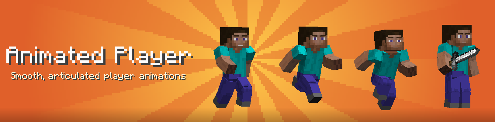

<b>Animated Player</b> gives every player a smooth, articulated body. Elbows and knees bend, the body leans into
each move, and the face comes alive with moving eyes, expressive eyebrows and a mouth that catches its breath.
It is a port of thehippomaster21's version, rebuilt for modern Minecraft.

## Animations

<table>
<tr>
<td width="55%"><h3>Walking</h3>
Arms and legs swing naturally, with bending elbows and knees and a light bounce of the body at every step.
</td>
<td width="45%" align="center">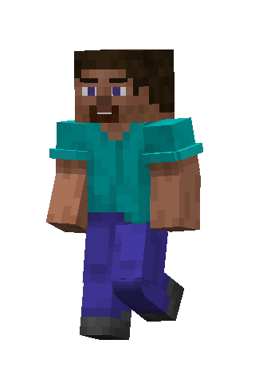</td>
</tr>
<tr>
<td width="45%" align="center">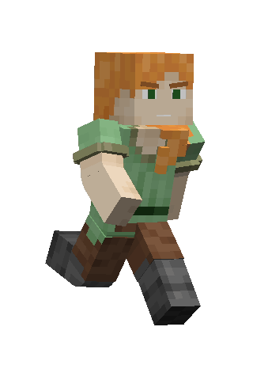</td>
<td width="55%"><h3>Sprinting</h3>
The body leans forward, the arms pump and the strides get longer.
</td>
</tr>
<tr>
<td width="55%"><h3>Sneaking</h3>
A real crouch: knees bent, back curved, careful steps.
</td>
<td width="45%" align="center">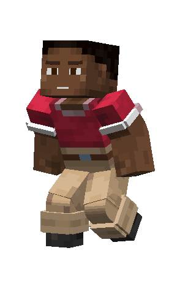</td>
</tr>
<tr>
<td width="45%" align="center">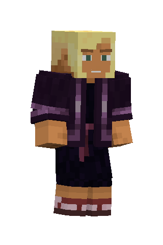</td>
<td width="55%"><h3>Idle</h3>
Standing still is never stiff: a relaxed stance and a slow breathing.
</td>
</tr>
<tr>
<td width="55%"><h3>Sword attack</h3>
A dedicated slash when holding a sword, with the whole body turning into the swing.
</td>
<td width="45%" align="center">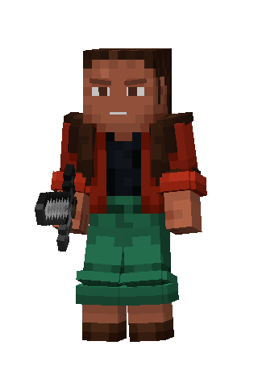</td>
</tr>
<tr>
<td width="45%" align="center">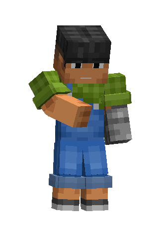</td>
<td width="55%"><h3>Eating and drinking</h3>
The hand brings the food to the mouth and the head moves while chewing.
</td>
</tr>
<tr>
<td width="55%"><h3>Climbing</h3>
Hands and feet alternate on ladders and vines.
</td>
<td width="45%" align="center">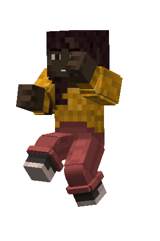</td>
</tr>
<tr>
<td width="45%" align="center">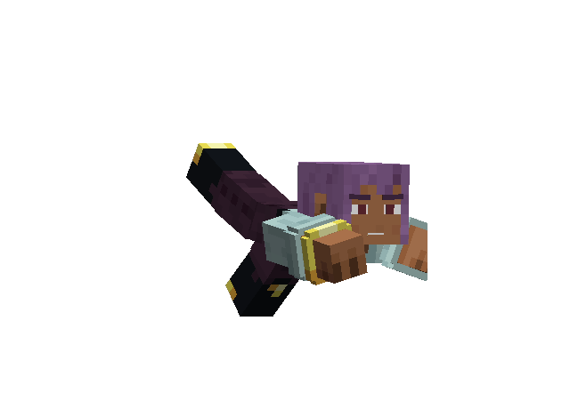</td>
<td width="55%"><h3>Swimming</h3>
Front crawl strokes and kicking legs.
</td>
</tr>
<tr>
<td width="55%"><h3>Crawling</h3>
Lying flat on the elbows to get through one block high gaps.
</td>
<td width="45%" align="center">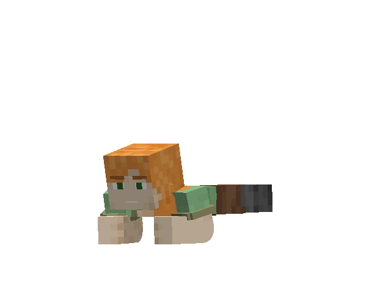</td>
</tr>
<tr>
<td width="45%" align="center">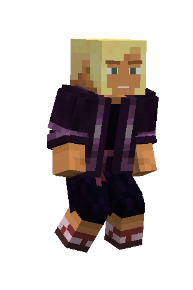 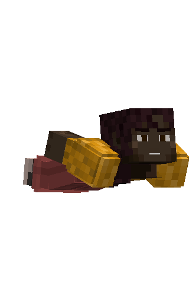</td>
<td width="55%"><h3>Flying</h3>
In creative mode the player hovers with dangling legs, or flies like a superhero with the optional superman pose, which is also used when gliding with an elytra.
</td>
</tr>
<tr>
<td width="55%"><h3>Animated face</h3>
Eyes follow where the player looks, eyebrows rise in a fight and frown when hungry, and the mouth opens to catch the breath after a sprint.
</td>
<td width="45%" align="center">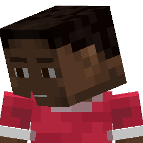</td>
</tr>
</table>

And much more: bow and crossbow aiming, spyglass, goat horn, trident throw and riptide, shield blocking, riding,
rowing a boat, parrots on the shoulders. Armor, held items, capes and elytras follow every joint, slim arms are
supported, and the second skin layer can be shown in 3D.

## Settings

Everything can be tuned from the settings screen (NeoForge mods list, or Mod Menu on Fabric).

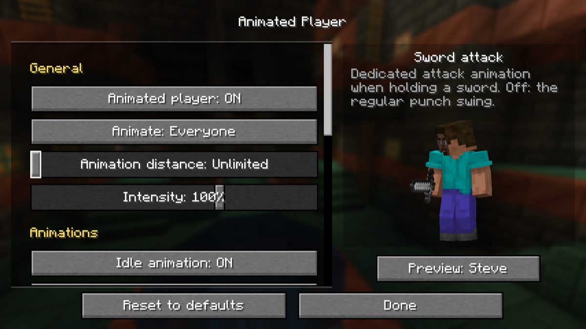

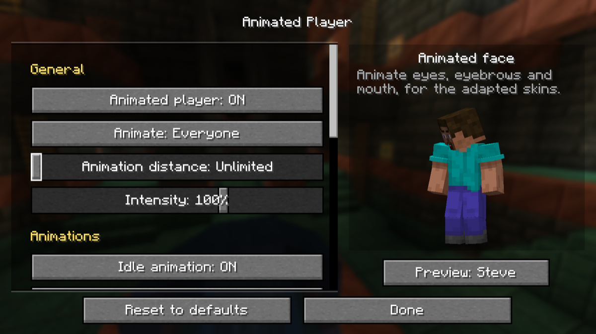

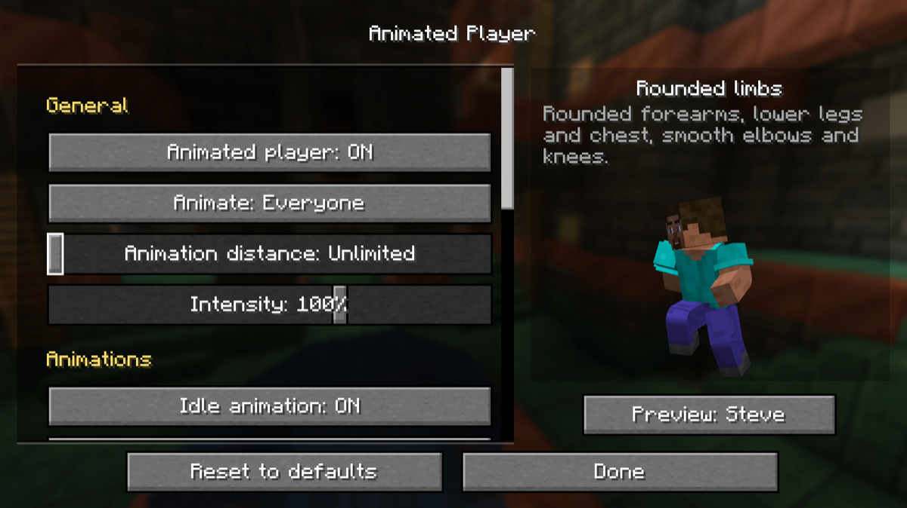

## Compatibility

Client side only: it can be used on any server. Tested with Sodium, Iris, ImmediatelyFast, Entity Model Features,
3D Skin Layers, Wavey Capes, Pehkui, Immersive Armors, Artifacts, Traveler's Backpack, First-person Model and
Do a Barrel Roll. Emotes from Emotecraft and attacks from Better Combat are shown with their own animations.

## Credits

Original mod: <b>thehippomaster21</b> (shcott21). This version is a port to modern Minecraft.

